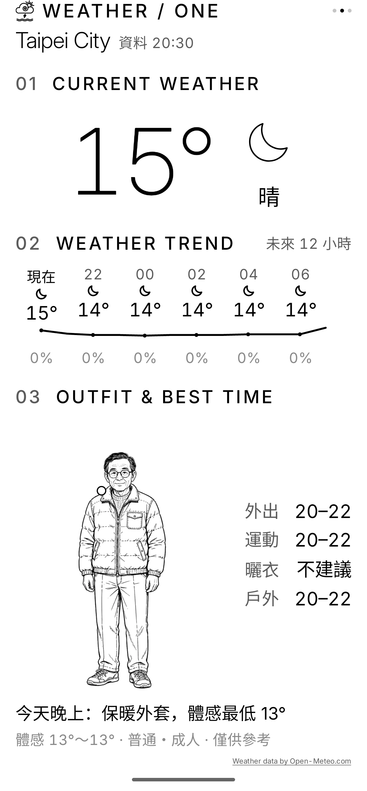

# WEATHER / ONE

一頁看完今天的天氣：現在幾度、接下來 12 小時、出門該穿什麼。黑白線條設計，沒有廣告、不用註冊。

## 下載

到 [Releases](https://github.com/JJptt1980/weather-one-beta/releases/latest) 下載 `weather-one.apk`，在手機上打開安裝（第一次要允許「安裝未知應用程式」）。

- 需要 Android 8.0 以上。
- 這裡的版本**免費**，是試用版。之後會在 Google Play 上架（付費），Play 版會從 1.0.0 開始。
- GitHub 版和 Play 版的簽章不同，不能直接從 GitHub 版升級成 Play 版，要先解除安裝。
- App 內會提示新版本；測試版（Pre-release）也放在這裡。

## 功能

- **WEATHER**：目前天氣、未來 12 小時、7 天與 16 天預報、圖表，多個預報模型比較。
- **OUTFIT**：依體感溫度、怕冷怕熱、年齡層建議穿著，附出門、運動、曬衣的最佳時段。
- **RADAR**：降雨雷達（台灣附近）、雲圖、風場、颱風路徑與地震。
- **GLOBAL**：收藏的城市放在一起比較。
- 桌面 Widget、天氣提醒、深色模式；字體大小跟著手機系統設定。

## 資料來源

- 天氣預報：[Weather data by Open-Meteo.com](https://open-meteo.com/)（CC BY 4.0）
- 降雨雷達：提供機關／交通部中央氣象署「雷達整合回波圖－臺灣（鄰近地區）透明底圖」
- 颱風路徑：提供機關／交通部中央氣象署「颱風消息與警報－熱帶氣旋路徑」
- 以上氣象署開放資料依[政府資料開放授權條款](https://data.gov.tw/license)進行公眾釋出。
- 地震：U.S. Geological Survey（USGS）。非官方警報，請以政府發布為準。
- 雲圖：NASA GIBS（向日葵影像依據日本氣象廳資料加工）、NOAA nowCOAST
- 地圖：© OpenFreeMap、© OpenMapTiles、© OpenStreetMap contributors
- 地形：AWS Terrain Tiles（USGS、Copernicus EU-DEM、NOAA ETOPO1 等）、NASA Blue Marble

開放原始碼元件的授權，在 App 的 ABOUT →「開放原始碼授權」。

## 隱私

- 不用帳號，不收集個人資料，沒有廣告或追蹤。
- 定位只用「大概位置」，用來查當地天氣；座標會送到上面的天氣服務與手機系統的地名查詢服務，不會送到我們的伺服器保存。
- 設定與收藏城市只存在你的手機裡。
